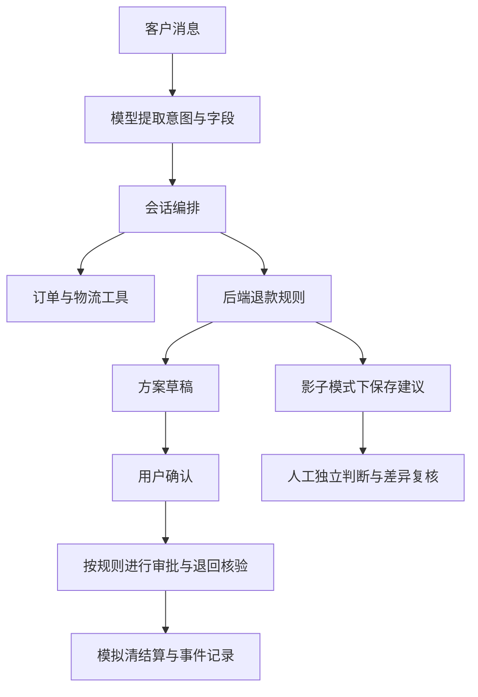

# AI 客服与售后 Agent

本地可运行的电商售后项目，包含客户会话、订单与物流查询、退款方案、分档审批、退回核验、人工工单、对话评测和影子对比。模拟清结算在 SQLite 中记录执行结果。

## 项目概览

客户通过自然语言查询订单、物流或申请退款。大模型提取意图、订单号和原因，后端读取订单并计算资格、金额和审批等级，用户确认方案后推进审批、退回核验和模拟执行。会话和退款事件均可回看。

| 能力 | 实现 |
|---|---|
| 语义识别 | 本地 Qwen、JSON Schema 输出约束、订单号溯源、异常时规则式降级 |
| 退款闭环 | 方案草稿、有效期与用户确认、金额审批、退回回执、模拟清结算 |
| 状态与一致性 | 会话与退款状态持久化、SQLite 事务、100 次并发确认防重复执行 |
| 质量验证 | 原回归集与语义挑战集、逐轮回放、影子盲评、人工基线更正历史 |
| 前后端 | Python 标准库 HTTP 服务、原生 JavaScript、SQLite |



下表为仓库内已保存的合成评测结果，包含 50 个原回归场景和 22 个语义挑战场景。各项按已标注轮次统计。原回归集两版均为 50/50 通过，模型版在退款原因识别和跨轮原因保留方面仍有待改进。

| 指标 | 规则式 | 模型版 |
|---|---:|---:|
| 业务动作正确 | 95/113 | 111/113 |
| 意图识别正确 | 76/84 | 83/84 |
| 订单号提取正确 | 16/22 | 22/22 |
| 退款原因提取正确 | 2/10 | 6/10 |
| 影子危险分歧 | 4/36 | 0/36 |

[查看逐轮评测报告](eval/model-comparison-qwen.json) · [查看设计与执行边界](docs/06-可运行项目设计与退款授权.md) · [查看演示流程与讲稿](视频录制流程稿与介绍稿.md)

项目使用演示账号、模拟订单和模拟资金执行，首次启动自动生成本地数据。运行日志、会话数据库、模型权重和本机环境配置由 Git 忽略规则排除。真实支付接入、可信物流回执及真实工单验证属于后续工作。

## 启动

在项目根目录 `ai-cs-agent` 使用 Python 3.11 或更高版本。前后端同源运行，无需安装 Python 或 Node.js 依赖包。

```powershell
python -X utf8 prototype/server.py
```

打开 [本地售后协作台](http://127.0.0.1:8765/)。首次启动创建 `data/demo.sqlite3` 并进入影子模式。会话、工单、授权和模拟退款记录跨重启保存。需要另开一套演示数据时，可用 `python -X utf8 prototype/server.py --port 8766 --db data/another-demo.sqlite3`。

## 演示流程

1. **影子对比**。默认身份是小林。对桌面收纳盒 `ORD20261101006` 点击「申请退款」。切换到「质量评测 → 质量运营」，在「实时影子样本」登记人工基线。这个订单待发货，基线填「生成方案」、169.00 元、「免审批」、「取消订单」。保存后可同时看到人工判断与系统建议。
2. **授权及小额直退**。在质量工作区点击「授权模拟退款」。回到小林的客户会话，再次对同一单申请退款，核对方案并点击「确认退款」。退款进度应显示 169.00 元模拟退款成功。
3. **审批与退回核验**。切换为阿哲，对 `ORD20261101003` 申请 1880.00 元退款并确认。切换客服主管，通过审批后，到「退回核验」登记「物流拦截已确认」的模拟回执。回到客户会话即可查看结果。3200.00 元的 `ORD20261101005` 进入财务审批。
4. **撤回授权**。质量工作区的「撤回模拟授权」会暂停确认、审批触发和退回执行。订单查询、退款进度和人工会话继续可用。

如果授权提示存在危险分歧，点击「授权模拟退款」可查看具体样本。逐条按采样时的订单快照复核，通过「复核并更正」填写正确基线和更正原因。历史判断保留，仍有危险分歧时继续阻止授权。界面金额以元填写，例如 299.00，接口内部仍使用整数分。已签收商品通常需要选择「退货退款」并核对退回条件。

| 演示账号 | 身份 | 可演示的场景 |
|---|---|---|
| 小林 `U1001` | 客户 | 169 元待发货取消、299 元退货退款、459 元超期 |
| 阿哲 `U1002` | 客户 | 1880 元 L1、3200 元 L2 |
| Vivian `U1003` | 客户 | 生鲜类目拒绝 |
| 客服主管 | L1 | 待办审批、退回回执、人工工单 |
| 财务审批 | L2 | 高金额审批 |
| 质量运营 | 运营 | 评测、影子对比、授权、审计 |

这些身份是本地演练账号，可在右上角切换。API 验证角色与资源归属。

## 验收

```powershell
python -X utf8 prototype/evaluate.py
python -X utf8 tests/smoke.py
python -X utf8 prototype/demo.py
```

评测集为 `eval/dialogues.json`。用 `python -X utf8 prototype/evaluate.py --output eval/report.json` 导出逐轮结果。HTTP 验收在临时库中运行，包含两个会话对同一订单发起的 100 次并发确认。

## 大模型识别与对比

模型只返回意图、订单号和退款原因。订单号必须来自当前消息提供的候选，发送前用临时代号替代单号并遮盖手机号。规则层继续处理订单归属、退款资格、金额、审批、回执和执行。确认按钮、人工审批以及出站执行均通过后端接口。

当前本机运行使用 Qwen2.5-1.5B-Instruct（Q4_K_M）和 llama.cpp b6101。模型和运行时放在 `data/nlu-runtime/`，可以在项目目录用下面的命令重新启动本地模型端点。换一台机器时，模型文件和相应系统的 llama.cpp 需要另行准备。[Qwen 权重与校验值](https://huggingface.co/Qwen/Qwen2.5-1.5B-Instruct-GGUF/blob/main/qwen2.5-1.5b-instruct-q4_k_m.gguf) · [llama.cpp b6101](https://github.com/ggml-org/llama.cpp/releases/tag/b6101)

```powershell
& .\data\nlu-runtime\llama-b6101\llama-server.exe -m .\data\nlu-runtime\qwen2.5-1.5b-instruct-q4_k_m.gguf --alias qwen2.5-1.5b-instruct-q4_k_m --host 127.0.0.1 --port 8767 -c 2048 -t 6 -np 1
```

在另一个 PowerShell 窗口运行。对照回放同时覆盖原 50 个回归场景和 22 个新增语义挑战场景，并分别统计意图、订单号、原因、动作及坐席基线分歧。

```powershell
$env:CS_LLM_BASE_URL = "http://127.0.0.1:8767/v1"
$env:CS_LLM_MODEL = "qwen2.5-1.5b-instruct-q4_k_m"
$env:CS_LLM_TIMEOUT = "20"
python -X utf8 prototype/evaluate.py --compare --output eval/model-comparison-qwen.json
python -X utf8 prototype/server.py --nlu model --nlu-report eval/model-comparison-qwen.json
```

打开 [模型版工作台](http://127.0.0.1:8765/)，可体验客户会话并在「质量评测」回看两组结果。可以加 `--port 8766 --db data/model-demo.sqlite3` 单独启动一套演示数据。运行对照时，退出码 1 表示候选未通过授权门槛，详细报告仍会输出。授权校验绑定模型及提示词版本与评测集，要求原回归集意图和动作无退化，并且模型调用无降级、无危险分歧。会话审计记录每轮识别来源及规则式降级原因。

本次 72 个合成场景中，模型版动作正确数由 95/113 提升至 111/113，意图由 76/84 提升至 83/84。36 组影子配对中，危险分歧从 4 组降到 0 组。模型 80 次调用均返回有效结果，本机 P95 为 3.01 秒。退款原因提取为 6/10，主要剩余问题是质量问题和买错、错货的区分，以及多轮补单号时保留原因。逐轮结果见 `eval/model-comparison-qwen.json`。

其他兼容端点可换用相应的 `CS_LLM_BASE_URL` 和 `CS_LLM_MODEL`。按服务需要设置 `CS_LLM_API_KEY`，只支持 JSON 模式的端点将 `CS_LLM_RESPONSE_FORMAT` 设为 `json`。默认使用 JSON Schema。模型不可用、响应格式异常或订单号无法溯源时，服务降级到规则式识别，报告单独计数。

## 文件位置

- `frontend/` 包含浏览器工作台。
- `prototype/server.py` 提供本地 HTTP 接口和 SQLite 请求事务。
- `prototype/orchestrator.py`、`prototype/rules.py`、`prototype/tools.py` 负责会话状态、退款规则和业务执行。
- `docs/06-可运行项目设计与退款授权.md` 说明执行边界、评测口径、上线授权结论及本地接口。
- `docs/01–05`、`api/openapi.yaml`、`db/schema.sql` 是压缩包提供的生产设计参考。
