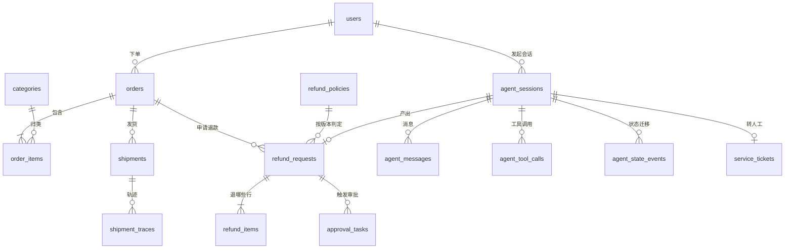

# 数据库设计 · AI 客服与售后 Agent

> 配套脚本：`db/schema.sql`（MySQL 8 DDL）、`db/seed.sql`（演示数据）
> 原型用 SQLite 等价实现（`prototype/db.py`），字段语义完全一致，便于本地跑通。

---

## 1. 设计取舍

| 决策 | 选择 | 理由 |
|---|---|---|
| 业务库与 Agent 库 | **同库、分表前缀** | 退款落单要与规则判定同事务，跨库会引入分布式事务成本 |
| 会话状态存哪 | **DB（`agent_sessions.state_payload`）+ 事件表** | 无状态服务、可水平扩容、可回放；Redis 只做热缓存 |
| 退款单与会话 | **解耦**（`refund_requests.session_id` 可空） | 会话 30 分钟过期，退款单生命周期数天 |
| 金额 | `DECIMAL(12,2)` | 禁止浮点，避免对账差 1 分 |
| 规则存哪 | **`refund_policies.rule_json` + 代码兜底默认值** | 运营可调、可灰度、可版本化；代码兜底防配置缺失 |
| 状态字段 | `ENUM` + 应用层状态机 | DB 拒绝脏值，应用层拒绝非法跃迁 |
| 幂等 | `idempotency_key` 唯一 + `(order_id, refund_seq)` 唯一 | 双保险，防并发重复退款 |
| 事件通知 | `outbox_events` | 避免"退款成功但消息没发"的不一致 |

### 为什么不用"一个 refunds 表 + 一个 JSON 字段存所有状态"

可解释性要求：事后必须能回答"当时按哪条规则、哪个版本、什么金额算出来的"。因此 `decision_snapshot` 存完整判定快照，`policy_version` 单独成列可索引统计。

---

## 2. 表清单（20 张）

### 2.1 业务域

| # | 表 | 说明 | 预估量级 |
|---|---|---|---|
| 1 | `users` | 用户主表 | 千万级 |
| 2 | `user_after_sale_stats` | 用户售后画像（退款率，供 BR-11） | 千万×月 |
| 3 | `categories` | 类目售后属性（是否支持无理由） | 千级 |
| 4 | `orders` | 订单主表 | 亿级 |
| 5 | `order_items` | 订单明细（行级退款计算） | 十亿级 |
| 6 | `shipments` | 物流单 | 亿级 |
| 7 | `shipment_traces` | 物流轨迹 | 百亿级（按需 TTL 归档） |
| 8 | `refund_policies` | 退款规则（版本化） | 百级 |
| 9 | `refund_requests` | 退款申请单 | 千万级 |
| 10 | `refund_items` | 退款明细 | 千万级 |
| 11 | `approval_tasks` | 人工审批任务 | 百万级 |

### 2.2 Agent 域

| # | 表 | 说明 | 预估量级 |
|---|---|---|---|
| 12 | `agent_sessions` | 会话与状态机当前态 | 千万级 |
| 13 | `agent_messages` | 消息流水 | 十亿级（按月分区） |
| 14 | `agent_tool_calls` | 工具调用审计 | 十亿级（按月分区） |
| 15 | `agent_state_events` | 状态迁移事件（事件溯源） | 十亿级（按月分区） |
| 16 | `service_tickets` | 转人工工单 | 百万级 |
| 17 | `knowledge_articles` | FAQ / 政策库 | 万级 |

### 2.3 基础设施

| # | 表 | 说明 |
|---|---|---|
| 18 | `idempotency_keys` | 接口幂等（24h TTL） |
| 19 | `outbox_events` | 事务性发件箱 |
| 20 | `audit_logs` | 操作审计（留存 3 年） |

---

## 3. 实体关系



---

## 4. 核心表字段详解

### 4.1 `orders` — 订单

| 字段 | 类型 | 说明 |
|---|---|---|
| `order_no` | VARCHAR(32) UK | 对外单号，用户口述的那串 |
| `status` | ENUM | 主状态：CREATED→PAID→SHIPPED→DELIVERED→COMPLETED |
| `after_sale_status` | ENUM | 售后汇总（NONE/APPLYING/REFUNDING/RETURNING/REFUNDED/PARTIAL_REFUNDED），冗余字段避免每次 join |
| `pay_amount` | DECIMAL(12,2) | **实付**，退款上限基准（BR-15） |
| `refunded_amount` | DECIMAL(12,2) | 累计已退，支持多次部分退 |
| `is_free_shipping` | TINYINT | 无理由退货时是否扣回运费（BR-13） |
| `has_excluded_item` | TINYINT | 含禁退类目标记，规则引擎可提前短路 |
| `delivered_at` | DATETIME | **BR-05/06 的时效基准**，不用 `updated_at`（会被无关更新污染） |
| `receiver_phone_tail4` | CHAR(4) | 二次身份校验，不存完整手机号 |
| `version` | INT | 乐观锁，防并发改单 |

> 注意：`delivered_at` 必须是物流签收时间，而不是订单系统状态变更时间。演示里 ORD2 签收于 11-05、订单完成于 11-12，若误用完成时间会少算 7 天。

### 4.2 `refund_requests` — 退款单（最重要的一张表）

| 字段 | 说明 |
|---|---|
| `refund_no` | 业务主键，用户可见 |
| `refund_type` | `CANCEL`（未发货取消）/ `REFUND_ONLY`（仅退款）/ `RETURN_REFUND`（退货退款） |
| `status` | 12 态状态机，见 04 文档 |
| `decision_code` | 规则引擎结论，如 `OK_NEED_APPROVAL_L1` |
| `decision_snapshot` | JSON：判定入参 + 命中规则 + 计算过程，客服解释/客诉复盘直接用 |
| `policy_version` | 判定时的规则版本，规则改了不影响历史单解释 |
| `apply_amount` / `approved_amount` | 申请额 vs 审批额（审批可改额，差额要留痕） |
| `refund_seq` | 同订单第几次退款，与 `order_id` 组成唯一键 → 天然防重复 |
| `confirm_token_hash` + `confirm_expire_at` | 确认令牌（只存哈希），一次性消费 |
| `idempotency_key` | 编排层生成，防用户狂点"确认" |
| `version` | 乐观锁，审批与用户取消并发时防覆盖 |

**金额拆解恒等式**（应用层断言）：

```
apply_amount = goods_amount + freight_refund - freight_deduct - discount_deduct
0 <= apply_amount <= order.pay_amount - order.refunded_amount
```

### 4.3 `approval_tasks` — 审批任务

- 一个退款单可有多条（L2 场景下 L1 先审、L2 终审），`level` 区分。
- `assignee_id` 为空表示池化抢单，避免审批人休假卡单。
- `sla_deadline` 落库，定时任务扫 `status=PENDING AND sla_deadline < now()` 触发升级。
- `decision_payload` 存审批人是否改额、改了多少、理由。

### 4.4 `agent_sessions` — 会话

| 字段 | 说明 |
|---|---|
| `state` | 会话状态机当前态（字符串而非 ENUM，便于新增态不锁表） |
| `state_payload` | JSON：槽位、待确认的 refund_no、最后展示方案指纹、失败计数 |
| `order_no_ctx` | 当前锁定订单，后续"那我要退"可继承上下文，不用重复报单号 |
| `fallback_count` | 连续兜底次数，≥3 自动转人工 |
| `human_takeover` | 坐席接管标记，为 1 时 Agent 静默 |
| `expires_at` | 30 分钟无活动过期，定时任务扫过期会话置 `EXPIRED` |

### 4.5 `agent_state_events` — 状态迁移事件

不存"最终状态"，存"每一次跃迁"。价值：

1. 断点续跑：从事件流重建状态，防 `state` 字段被脏写。
2. 归因分析：某类退款失败集中在哪个跃迁（如 `PROPOSAL_PENDING → ABORTED` 占比高 = 方案话术有问题）。
3. 合规：监管问"为什么退的"，逐条事件可答。

---

## 5. 索引策略

| 场景 | 索引 | 说明 |
|---|---|---|
| 用户查最近订单 | `orders(user_id, created_at DESC)` | 覆盖"我的订单"列表 |
| 客服按单号查 | `orders(order_no)` UK | 主查询路径 |
| 审批工作台 | `approval_tasks(status, level, sla_deadline)` | 待办列表 + 超时扫描 |
| 退款进度查询 | `refund_requests(user_id, status)` | 用户侧"我的退款" |
| 同单防重 | `refund_requests(order_id, refund_seq)` UK | 幂等核心 |
| 工具调用排查 | `agent_tool_calls(tool_name, status)` | 定位某工具错误率 |
| 消息拉取 | `agent_messages(session_id, seq)` UK | 会话回放 |
| 物流轨迹 | `shipment_traces(shipment_id, trace_time DESC)` | 只取最近 3 条 |

**不使用** `%like%` 模糊查订单号；用户输入先做格式校验（`^ORD\d{11}$`）再走精确索引。

---

## 6. 一致性与并发

### 6.1 退款确认并发

```
BEGIN;
  SELECT ... FROM refund_requests WHERE refund_no=? FOR UPDATE;      -- 行锁
  -- 校验 status=DRAFT/ELIGIBLE 且 token 未过期未消费
  UPDATE refund_requests SET status='USER_CONFIRMED', confirm_token_hash=NULL,
         version=version+1 WHERE id=? AND version=?;                  -- 乐观锁双保险
  INSERT INTO approval_tasks ...;                                     -- 需审批时
  INSERT INTO agent_state_events ...;
  INSERT INTO outbox_events ...;
COMMIT;
```

### 6.2 重复确认

`idempotency_key` 唯一键冲突 → 捕获 `DuplicateKey` → 返回首次结果（`idempotency_keys.response_body`），不报错。用户看到的是"已提交，请勿重复操作"。

### 6.3 退款执行

- 提交清结算前先写 `outbox_events(NEW)`，同事务。
- 独立 dispatcher 轮询发送，成功后置 `SENT`；失败指数退避重试，超 3 次告警。
- 清结算回执通过 webhook 回写 `status=SUCCESS/FAILED`。

### 6.4 会话并发

同一 `session_no` 的消息串行处理：Redis `SETNX session_lock:{id} 5s`，拿不到锁则排队（前端已有 loading 态，正常不会触发）。

---

## 7. 容量与归档

| 表 | 日增 | 策略 |
|---|---|---|
| `agent_messages` | 200 万 | 按月分区，热数据 3 个月，冷数据归档 OSS |
| `agent_tool_calls` | 300 万 | 同上，保留 6 个月明细，聚合指标永久保留 |
| `agent_state_events` | 150 万 | 保留 1 年，之后只留终态 |
| `shipment_traces` | 500 万 | 保留 6 个月，超期归档 |
| `audit_logs` | 20 万 | 保留 3 年（合规） |
| `idempotency_keys` | 100 万 | TTL 24h 定时清理 |

分库分表建议：`orders` / `order_items` 按 `user_id` 哈希分 64 库；`refund_requests` 按 `user_id` 分片保证同用户事务本地化。Agent 表按 `session_id` 分片。

---

## 8. 附录 A：`rule_json` 结构

```json
{
  "no_reason_days": 7,
  "max_refund_times": 2,
  "auto_approve_limit": 500,
  "l1_limit": 2000,
  "freight_deduct_on_no_reason": true,
  "refund_rate_threshold": 0.60,
  "excluded_categories": ["VIRTUAL", "CUSTOM", "FRESH", "UNDERWEAR"],
  "forbid_status": ["CREATED", "CANCELLED", "CLOSED"],
  "sla_hours": { "L1": 4, "L2": 8 },
  "quality_only_after_days": 7
}
```

字段含义与 BR 编号一一对应，规则引擎按 `scope_type + scope_value + priority` 解析：类目级 > 会员级 > 全局，同级取 `priority` 大者，再按 `effective_from` 取最新版本。

## 9. 附录 B：状态值一览

| 表 | 字段 | 取值 |
|---|---|---|
| `orders` | `status` | CREATED, PAID, SHIPPED, DELIVERED, COMPLETED, CANCELLED, CLOSED |
| `orders` | `after_sale_status` | NONE, APPLYING, REFUNDING, RETURNING, REFUNDED, PARTIAL_REFUNDED |
| `refund_requests` | `status` | DRAFT, ELIGIBLE, USER_CONFIRMED, PENDING_APPROVAL, APPROVED, PROCESSING, SUCCESS, FAILED, REJECTED_BY_RULE, REJECTED_BY_HUMAN, CANCELLED, EXPIRED |
| `approval_tasks` | `status` | PENDING, APPROVED, REJECTED, TRANSFERRED, EXPIRED, CANCELLED |
| `agent_sessions` | `state` | INIT, AUTH_VERIFY, INTENT_RESOLVED, COLLECTING_SLOT, TOOL_RUNNING, PROPOSAL_PENDING, EXECUTING, PENDING_APPROVAL, COMPLETED, ESCALATED, ABORTED, EXPIRED |
